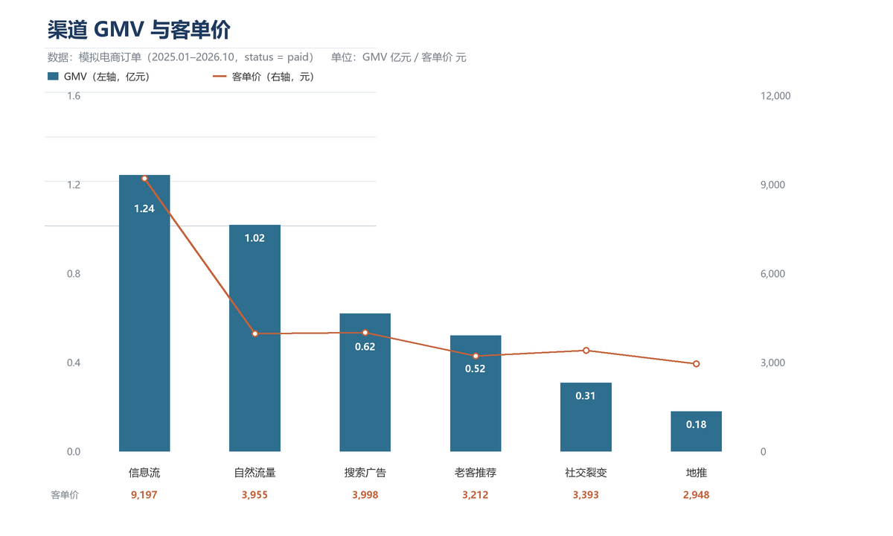
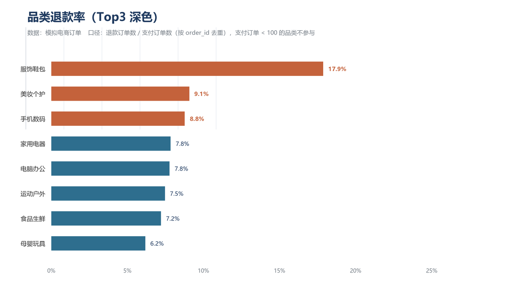
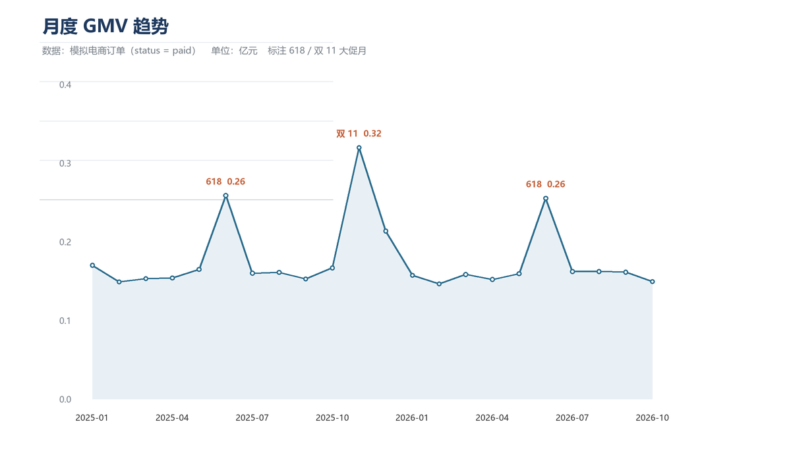

# 分析结论：模拟电商订单（2025.01–2026.10）

> 数据为 Python 脚本模拟生成，结论只针对这套数据，不代表真实业务。
> 所有数字来自 `sql/` 下脚本在 MySQL 8.0 的真实执行结果（`results/` 为原始输出）。

---

## 一、总览

| 指标 | 数值 |
|---|---:|
| 支付订单数 | 86,014 |
| GMV（仅 paid） | 3.88 亿元 |
| 整体客单价 | 4,515 元 |
| 有支付订单的用户 | 33,586 |
| 22 个月内下过 2 单以上的用户占比 | 63.4% |
| 首单后 30 天内复购率 | 14.7% |

---

## 二、核心发现

### 1. 信息流：规模与客单价双高，但复购最差

| 渠道 | 支付订单 | 买家数 | GMV（万元） | 客单价（元） | 复购率 |
|---|---:|---:|---:|---:|---:|
| 信息流 | 13,488 | 8,501 | 12,404.6 | 9,196.79 | 51.8% |
| 自然流量 | 25,712 | 12,496 | 10,169.7 | 3,955.22 | 65.8% |
| 搜索广告 | 15,477 | 8,337 | 6,188.0 | 3,998.17 | 61.3% |
| 老客推荐 | 16,189 | 4,161 | 5,200.4 | 3,212.31 | **85.0%** |
| 社交裂变 | 9,073 | 5,076 | 3,078.9 | 3,393.49 | 61.8% |
| 地推 | 6,075 | 3,427 | 1,790.8 | 2,947.80 | 62.0% |

- 信息流客单价 9,197 元，是自然流量（3,955 元）的 2.3 倍，GMV 也最高（1.24 亿）。
- 但信息流复购率只有 51.8%，是六个渠道里最低的；老客推荐 85.0% 最高，客单价却最低（3,212 元）。
- 结论：**信息流擅长拉新和拉高单笔，不擅长留存**；老客推荐相反。

### 2. 服饰鞋包退款率 17.9%，是第二名的近 2 倍

| 品类 | 支付订单 | 退款订单 | 退款率 |
|---|---:|---:|---:|
| 服饰鞋包 | 13,626 | 2,433 | **17.9%** |
| 美妆个护 | 5,165 | 468 | 9.1% |
| 手机数码 | 25,340 | 2,219 | 8.8% |
| 其余 5 个品类 | — | — | 6.2%–7.8% |

服饰鞋包在信息流渠道内更高，达 18.4%（`sql/11`），说明不是渠道问题，而是品类本身（尺码、色差、详情页预期）。

### 3. 大促月份 GMV 翻倍，次月回落 33%–38%

- 2025-06（618）：2,586 万元，环比 **+57.1%**
- 2025-11（双 11）：3,195 万元，环比 **+91.8%**，是全年峰值
- 2025-12：2,133 万元，环比 −33.2%
- 2026-06（618）：2,551 万元，环比 **+60.2%**；2026-07 环比 −36.5%

大促月份的增量有明显“透支”特征：大促后一个月回落幅度与当月涨幅基本对称。

### 4. 其他结果

- **品类 Top3 商品**（`sql/07`）：手机数码第一名单品 GMV 307.9 万元，家用电器前三名在 173–194 万元；服饰鞋包第一名单品仅 34.1 万元 —— 高客单价品类的头部集中度更高。
- **渠道 × 品类**（`sql/11`）：信息流 × 电脑办公客单价 13,143 元最高，信息流 × 手机数码贡献 6,741 万元；服饰鞋包在六个渠道的退款率都在 17.5%–18.4%，与渠道无关。
- **连续下单**（`sql/10`）：最长连续 8 个月下单（用户 3782、12159）；有连续 3 个月以上下单记录的用户 1,444 人，占有支付用户 4.3%。
- **最近一单**（`sql/09`）：用于算“用户当前状态”，可支撑流失召回名单。

---

## 三、建议

1. **信息流别只加投放**：拉新和客单价已经很强，下一步用配件、延保、会员权益做二次转化，把 51.8% 的复购率拉到渠道均值（约 62%）。
2. **老客推荐的客单价是短板**：复购 85% 说明信任度高，适合做“以旧换新/套装升级”来抬客单价，而不是拉新奖励。
3. **服饰鞋包先修退款**：退款率 17.9% 是其他品类的 2 倍，优先排查尺码表、详情页实拍、质检和物流破损；每降 1 个百分点约等于挽回 136 单。
4. **大促预算前置**：618/双 11 的增量会在次月回落，备货与投放应按“大促月 + 平销月”整体核算 ROI，并在平销月做复购活动平滑波动。

---

## 四、口径说明

| 指标 | 口径 |
|---|---|
| GMV | `status = 'paid'` 的 `total_amount` 之和（`v_orders_clean`） |
| 客单价 | GMV / 支付订单数 |
| 退款率 | 退款订单数 / 支付订单数，均按 `order_id` 去重；支付订单 < 100 的品类不参与排名 |
| 复购率（渠道） | 支付订单数 ≥ 2 的用户 / 该渠道有支付订单的用户；**渠道按用户注册渠道归因** |
| 30 天复购率 | 首单后 1–30 天内还有支付订单的用户 / 有支付订单的用户 |
| 连续下单 | 按 `EXTRACT(YEAR_MONTH)` 去重后做“月份序号 − 行号”分组，段长 ≥ 3 |

## 五、局限

- 模拟数据：渠道、品类的差异是生成时设定的分布，结论不能外推到真实业务。
- 未做用户分层、RFM、AB 实验；退款率未区分“部分退款/整单退款”。
- 时间跨度 22 个月，不足以做年度季节性判断（只有一次完整 618 和双 11 对照）。
